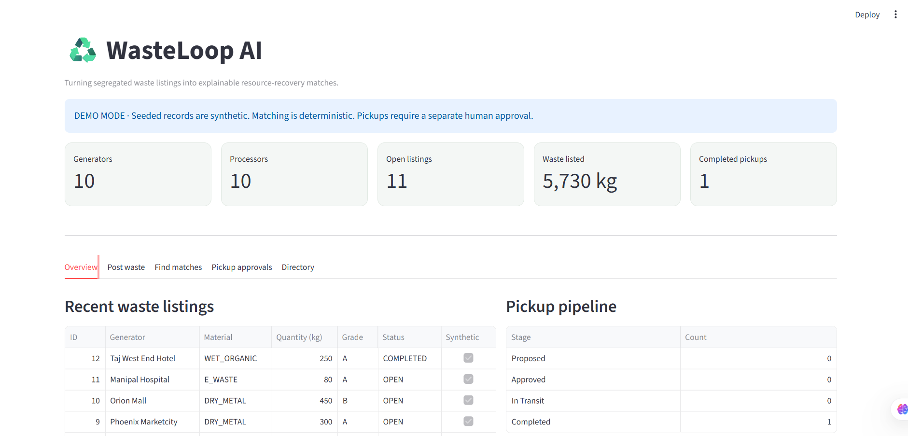
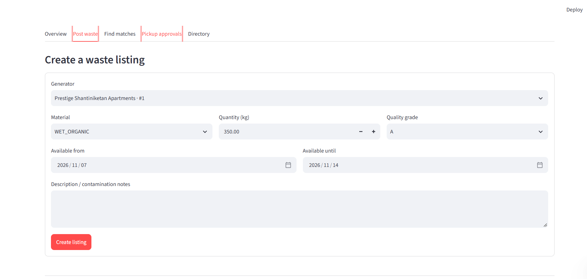
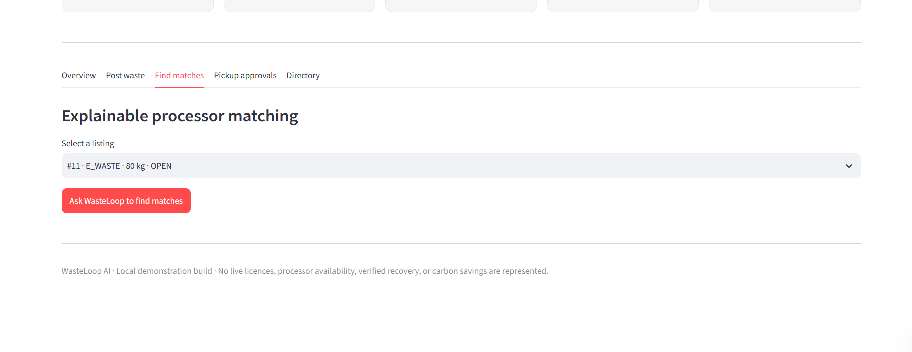
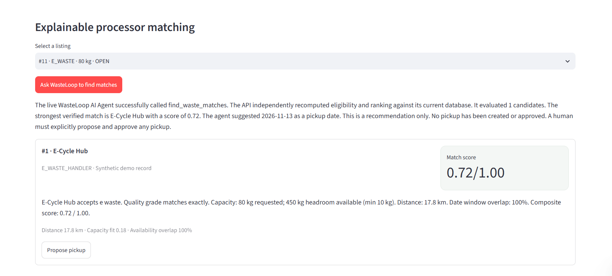
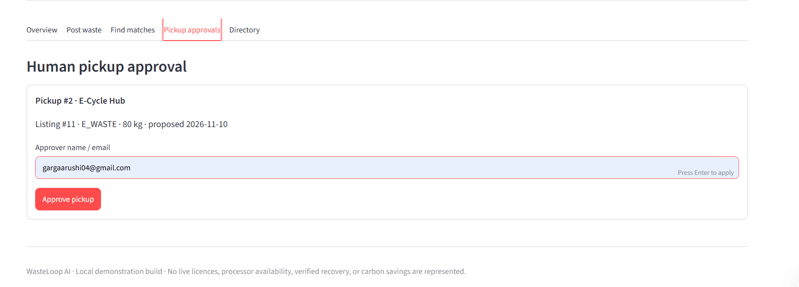
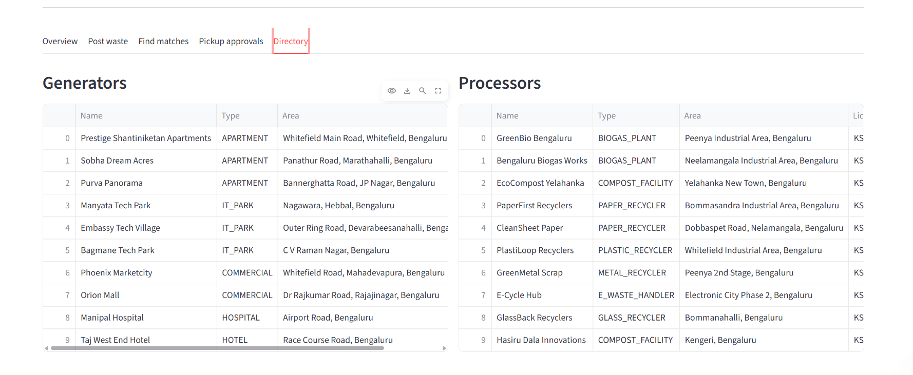

# WasteLoop AI
### Smarter waste discovery, intelligent matching, and human-approved recovery for Bengaluru

**Problem:** Bulk waste generators in Bengaluru often struggle to identify suitable nearby waste processors and coordinate pickups. WasteLoop AI simplifies this process through structured waste listings, intelligent processor matching, and human-supervised pickup coordination.

Built for **IBM Bobathon 2026 — Build for Bengaluru**

---

## 1. What is WasteLoop AI?

WasteLoop AI is an AI-assisted waste coordination platform that connects bulk waste generators with suitable waste processors.

Generators can list available waste, receive ranked processor recommendations, understand why processors were matched, and propose pickups. Processors are evaluated using material compatibility, quality requirements, available capacity, geographical proximity, and date availability.

The platform combines IBM watsonx Orchestrate with a deterministic Python matching engine. AI makes the interaction easier to understand, while backend validation keeps matching decisions consistent and independently verifiable.

**The key principle: AI-assisted discovery, deterministic matching, and human-controlled decisions.**

## 2. Core Workflow

1. **List waste:** A generator submits material type, quantity, quality grade, location, and availability.
2. **Find matches:** The user requests processor recommendations through the WasteLoop interface.
3. **Review recommendations:** The system displays ranked processors, distances, scores, and explanations.
4. **Propose pickup:** A proposed pickup is created for a selected processor.
5. **Human approval:** The pickup requires an explicit approval action.
6. **Track progress:** The pickup moves through its lifecycle until completion.

Pickup lifecycle:

`PROPOSED → APPROVED → IN_TRANSIT → COMPLETED`

Pickups can also be cancelled from a non-terminal state. The agent does not independently approve or complete pickups.

## 3. Matching Engine

The matching engine is implemented in `matching/engine.py`.

It uses a two-stage process:

**Stage 1 — Hard eligibility checks**

Processors are rejected when they fail mandatory requirements, including:

- `material_mismatch`
- `grade_too_low`
- `quantity_below_minimum`
- `insufficient_capacity_headroom`
- `no_date_overlap`

**Stage 2 — Weighted ranking**

Eligible processors are ranked using the following scoring weights:

| Matching criterion | Weight |
|---|---:|
| Material compatibility and quality | 35% |
| Capacity fit | 25% |
| Geographic proximity | 20% |
| Date availability overlap | 20% |

Geographic distance uses the Haversine formula with an Earth radius of 6,371 km. The distance score is capped at a 50 km reference distance.

This is straight-line coordinate distance, not road or live GPS distance.

The matching engine is deterministic: the same inputs and data produce the same results.

## 4. Technology Stack

| Component | Technology |
|---|---|
| Frontend | Streamlit |
| Backend | FastAPI |
| Database | SQLite, with configurable PostgreSQL support |
| ORM | SQLAlchemy |
| AI orchestration | IBM watsonx Orchestrate |
| Agent | `wasteloop_agent` |
| Matching logic | Python |
| Testing | pytest |

## 5. System Architecture

```text
             GENERATOR / USER
                    |
                    v
             STREAMLIT FRONTEND
                    |
                    v
              FASTAPI BACKEND
                    |
                    v
          IBM watsonx Orchestrate
                    |
                    v
              WasteLoop Agent
                    |
                    v
           find_waste_matches Tool
             (READ_ONLY access)
                    |
                    v
         Ranked recommendations
          + explanations + ID
                    |
                    v
          BACKEND REVALIDATION
                    |
                    v
          Deterministic Matching
              Engine + DB
                    |
                    v
             RESULTS TO USER
                    |
                    v
          HUMAN-INITIATED ACTION
                    |
                    v
            PICKUP PROPOSAL
                    |
                    v
          EXPLICIT APPROVAL
                    |
                    v
           PICKUP STATUS TRACKING
```

The Orchestrate tool operates on a versioned synthetic snapshot. The FastAPI backend independently recomputes and validates the matching results against its database before presenting the final recommendations.

This separation is intentional: the agent provides natural-language interaction and explanations, while deterministic backend logic provides consistency and validation.

The agent's matching tool is read-only. Pickup creation and status transitions are handled through separate backend operations initiated by the user.

## 6. IBM watsonx Orchestrate Integration

WasteLoop AI uses IBM watsonx Orchestrate to provide an agent-based interface for processor discovery.

**Agent configuration:** `agents/wasteloop_agent.yaml`

The `wasteloop_agent` is configured with a ReAct-style interaction flow and the `find_waste_matches` tool.

**Matching tool:** `tools/find_waste_matches.py`

The tool:
- Accepts structured waste listing inputs.
- Evaluates candidate processors using the matching logic.
- Returns ranked recommendations and score breakdowns.
- Provides explanations for the recommendations.
- Returns a snapshot identifier so the result can be traced to its data snapshot.
- Operates with read-only permissions.

The agent presents the recommendations to the user, but does not independently create, approve, or complete pickups.

### Why use both an AI agent and deterministic matching?

The agent makes the system easier to interact with through natural-language requests and explanations. The deterministic matching engine handles eligibility and scoring, and the backend independently validates the result.

This avoids relying on an LLM to make final operational decisions.

## 7. Application Features

The Streamlit application in `app/streamlit_app.py` is organised into five main areas:

- **Overview:** Dashboard with generator, processor, listing, and pickup statistics.
- **Post Waste:** Create and manage waste listings. Users can select an existing generator or register a new generator directly in the workflow before submitting a listing.
- **Find Matches:** Request and review processor recommendations, including scores, distances, and explanations.
- **Pickup Approvals:** Propose pickups, explicitly approve them, and track their status.
- **Directory:** Browse generator and processor records.

Application screenshots:













The application uses synthetic demonstration records. These are explicitly identified as synthetic rather than presented as verified real-world registrations.

## 8. Prototype Verification

WasteLoop AI has been tested as a working end-to-end prototype.

### Live Orchestrate integration

A successful live IBM watsonx Orchestrate invocation was verified through the Streamlit interface.

Live IBM watsonx Orchestrate integration was successfully tested through the Streamlit application with mock mode disabled. In the recorded test:
- Four candidate processors were evaluated.
- Three eligible recommendations were returned.
- Each recommendation included a score and distance.
- The backend independently recomputed and validated the results.

### Pickup lifecycle

The following workflow was manually tested:

1. Requested processor matches.
2. Proposed a pickup with the top-ranked processor.
3. Approved the pickup.
4. Changed its status to `IN_TRANSIT`.
5. Marked the pickup `COMPLETED`.

The completed pickup was also verified through the backend API.

### Automated tests

<badge color="success">72 tests passed</badge>

| Test file | Tests passed |
|---|---:|
| `tests/test_matching.py` | 37 |
| `tests/test_matching_drift.py` | 20 |
| `tests/test_api.py` | 15 |
| **Total** | **72** |

The tests cover matching eligibility, scoring, consistency between matching implementations, API behaviour, and pickup workflow rules.

## 9. Prototype Impact and Measurement

The prototype demonstrates a structured workflow for discovering suitable processors and coordinating a human-approved pickup.

In the recorded live-agent demonstration, the system evaluated four candidate processors and returned three eligible recommendations. The automated test suite has 72 passing tests, and the pickup lifecycle was manually verified through completion.

The prototype has **not** yet measured time saved against a manual search baseline, verified recovered waste tonnage, or quantified carbon savings. Those outcomes require controlled measurements and real-world operational data; no such impact is claimed at this stage.

## 10. Running the Project

### Prerequisites

- Python 3.10 or later
- Git
- IBM watsonx Orchestrate access for live agent functionality

### Clone the repository

```bash
git clone https://github.com/aarucodes/WasteLoop-AI.git
cd WasteLoop-AI
```

### Create a virtual environment

```bash
python -m venv venv
```

Windows:

```bash
venv\Scripts\activate
```

### Install dependencies

```bash
pip install -r requirements.txt
```

### Configure environment

The application uses SQLite by default. `DATABASE_URL` can be configured to use PostgreSQL with the appropriate database driver installed.

`USE_MOCK_AGENT` defaults to `true` for local development and mock-mode testing.

For the actual hackathon demonstration, use the deployed IBM watsonx Orchestrate agent and the live integration rather than mock mode.


### Start the backend

```bash
uvicorn api.main:app --reload
```

### Start the frontend

In a separate terminal:

```bash
streamlit run app/streamlit_app.py
```

### Run tests

```bash
pytest
```

## 11. Demo Data and Current Limitations

WasteLoop AI is currently a functional prototype, not a production waste-management network.

The following limitations are important:

- Generator, processor, capacity, and listing records are synthetic demonstration data.
- Processor names do not represent verified partnerships.
- The prototype does not verify actual KSPCB or CPCB authorisations.
- No real-world waste collection or processing has been independently verified.
- Completed demo pickups do not establish verified material recovery.
- No carbon savings or environmental credits are claimed.
- Haversine distance represents straight-line distance, not actual road travel.
- The current prototype has not been validated through a live municipal deployment.

The platform is designed to demonstrate the workflow and technical architecture. Real-world deployment would require processor onboarding, regulatory checks, operational validation, and appropriate agreements.

## 12. Future Scope

All phases below are planned enhancements. They are not represented as implemented features.

### Phase 1 — Trust and real-world validation
- Onboard real generators and processors.
- Introduce KYC and licence-document collection.
- Verify relevant authorisations against issuing authority records.
- Add role-based access control and audit logging.
- Introduce SMS and WhatsApp notifications.
- Conduct a ward-level pilot with appropriate local stakeholders.

### Phase 2 — Better matching and coordination
- Use historical pickup and processing records to improve recommendations.
- Support processor-managed, dynamically updated capacity.
- Add road-distance and route-aware matching.
- Introduce demand forecasting and operational alerts.
- Explore multi-stop pickup coordination.

### Phase 3 — Accessibility and traceability
- Add Kannada and English language support.
- Explore WhatsApp-based access for smaller waste generators.
- Provide segregation guidance while users create waste listings.
- Add pickup evidence, actual weight records, processor receipts, and material traceability.
- Explore integrations with relevant municipal systems, subject to permissions and agreements.

### Phase 4 — Waste reduction and marketplace capabilities
- Develop a two-sided generator and processor directory.
- Provide personalised waste-reduction and segregation suggestions.
- Explore price discovery between generators and processors.

## 13. How IBM Bob Helped Build This Project

IBM Bob was used as an AI development collaborator throughout the creation of WasteLoop AI. Its contribution extended across architecture, code generation, implementation, debugging, test development, integration support, and documentation—not just isolated code suggestions.

The following describes Bob's contributions in relation to the project files and the development work completed.

> Bob assisted with design, code generation, and debugging. Generated code and recommendations were reviewed, adapted, integrated, and tested by the project author. Platform setup, agent registration, live invocation, and end-to-end validation were also carried out by the project author.

### Architecture and system design

Bob helped design and document the core architectural decisions:

- **Two-layer matching architecture:** The authoritative matching logic lives in `matching/engine.py` as a pure Python module. An inline implementation is embedded in `tools/find_waste_matches.py` for the Orchestrate tool. The `tests/test_matching_drift.py` suite enforces parity between the implementations.
- **Human-in-the-loop pickup boundary:** The agent returns recommendations; it does not approve or create pickups. Pickup creation and approval are separate backend operations.
- **Flat-scalar tool inputs:** Bob recommended scalar inputs for the Orchestrate tool signature to avoid nested-object serialization issues.
- **Application flow:** Bob assisted with the Streamlit and FastAPI structure and the data flow between the agent, matching tool, backend, and database.

### Data models, schemas, and database

Bob generated and refined initial implementations of:

- `api/models.py` — SQLAlchemy models for generators, waste listings, processors, processor capacities, matches, and pickups, including application enums and synthetic-data flags.
- `api/schemas.py` — Pydantic request and response schemas with validation.
- `api/database.py` — database engine configuration, session management, and database initialization.

### Backend API

Bob assisted with the FastAPI implementation in `api/main.py`, including endpoints for:

- `GET /health`
- `GET /dashboard/summary`
- `GET /generators` and `POST /generators`
- `GET /processors` and `POST /processors`
- `GET /processor-capacities` and `POST /processor-capacities`
- `GET /waste-listings` and `POST /waste-listings`
- `GET /matching/{listing_id}`
- `POST /agent/match`
- `GET /pickups` and `POST /pickups`
- `PATCH /pickups/{pickup_id}/status`

Bob also helped develop shared conversion and validation logic and the pickup state-transition rules. The project author reviewed and integrated the backend changes and tested the API behaviour.

### Matching engine

Bob played a major role in developing `matching/engine.py`, including:

- `haversine_km` — great-circle distance between latitude/longitude points.
- Dimension scorers for material, quality, quantity, distance, and availability.
- `is_eligible` — hard eligibility checks with machine-readable rejection reasons.
- `build_explanation` — deterministic plain-English match explanations.
- Dataclasses such as `ListingInput`, `CapacityInput`, `ProcessorInput`, `ScoreBreakdown`, and `MatchResult`.
- `score_processor_for_listing` and `find_matches` — processor scoring, ranking, tie-breaking, and top-result selection.

### IBM watsonx Orchestrate integration

Bob generated initial versions of, and assisted with the configuration of:

- `tools/find_waste_matches.py` — the `@tool`-decorated tool with `ToolPermission.READ_ONLY`, an embedded synthetic processor snapshot, and matching logic kept in sync with the backend engine.
- `agents/wasteloop_agent.yaml` — the `wasteloop_agent` definition, instructions, tool configuration, and starter prompts.

The tool uses flat scalar inputs and returns ranked recommendations, score details, explanations, and a snapshot identifier. The agent is restricted to matching and recommendations; pickup operations remain under backend and human control.

The project author registered the agent and tool in IBM watsonx Orchestrate and verified the live end-to-end invocation through the Streamlit application with mock mode disabled.

### Frontend development

Bob generated and refined the Streamlit interface in `app/streamlit_app.py`, covering the overview dashboard, waste listing, matching, pickup approvals, and directory views.

Bob also assisted with the newer frontend structure:
- `app/common.py` — shared application utilities.
- `app/pages/` — separate Streamlit pages for generator and processor workflows.

The Post Waste workflow was extended to let a user register a new generator through the existing generator API and then select that generator for the waste listing.

### Testing and debugging

Bob generated initial versions of the test suites and assisted with debugging and test refinement:

- `tests/test_matching.py` — matching scorers, eligibility filters, composite scoring, ranking, tie-breaking, and end-to-end matching.
- `tests/test_matching_drift.py` — parity between the backend matching engine and the Orchestrate tool implementation.
- `tests/test_api.py` — API endpoints, generator creation and validation, matching, and pickup workflow rules.

The current automated test run completed with **72 passing tests**: 37 matching tests, 20 matching-drift tests, and 15 API tests. The project author reviewed and supplemented the tests during integration.

### Documentation and demo data

Bob assisted in drafting and refining the README, repository documentation, setup guidance, and synthetic demonstration data. The project author reviewed the final descriptions and added limitations to distinguish prototype functionality from verified real-world outcomes.

### Human review and validation

Bob's generated code and recommendations were reviewed, adapted, integrated, and tested. The project author handled the IBM watsonx Orchestrate platform setup and registration, verified the live agent invocation, ran the automated test suite, and manually tested the pickup lifecycle through completion.

**WasteLoop AI demonstrates how IBM Bob can contribute beyond code completion: from system architecture and implementation to integration, debugging, testing, and documentation of a working AI-assisted application.**

---

## 14. Repository Structure

```text
WasteLoop-AI/
│
├── agents/
│   └── wasteloop_agent.yaml
│
├── api/
│   ├── database.py
│   ├── main.py
│   ├── models.py
│   └── schemas.py
│
├── app/
│   ├── common.py
│   ├── pages/
│   │   ├── 1 apartments
│   │   └── 2 processor
│   └── streamlit_app.py
│
├── matching/
│   └── engine.py
│
├── tests/
│   ├── test_api.py
│   ├── test_matching.py
│   └── test_matching_drift.py
│
├── tools/
│   └── find_waste_matches.py
│
├── requirements.txt
└── README.md
```

---

**WasteLoop AI — Smarter Streets, Better Living.**

*Built with Python, Streamlit, FastAPI, IBM watsonx Orchestrate, and IBM Bob.*
